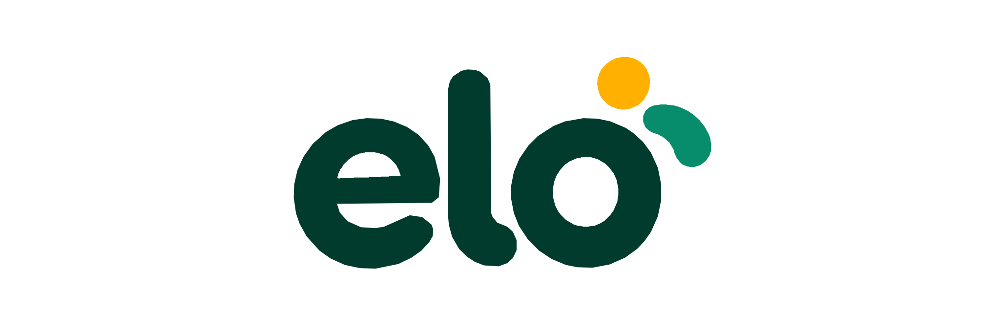
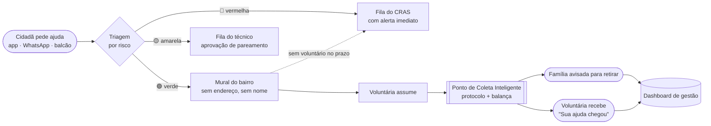
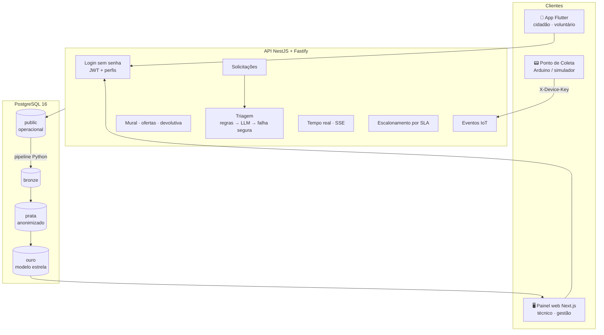

<div align="center">



### Cidadãos conectam. Comunidades fortalecem. O município avança.

**Plataforma municipal de mobilização solidária e triagem da demanda socioassistencial.**

[](https://github.com/gugow06/elo/actions/workflows/ci.yml)


[Sobre](#-sobre) · [Como funciona](#-como-funciona) · [Arquitetura](#-arquitetura) · [Começando](#-começando) · [Global Solution](#-as-4-áreas-da-global-solution) · [Qualidade](#-qualidade-e-segurança) · [Roadmap](#-roadmap)

</div>

---

## 💡 Sobre

A equipe do CRAS é pequena para a demanda que recebe. Boa parte dos pedidos que chegam (cesta básica, roupa, colchão, material escolar) **não precisa de um técnico de nível superior: precisa de um vizinho disponível.** Ao mesmo tempo, quem quer ajudar não sabe quem precisa, e quem precisa não quer se expor, com razão.

O **ELO** conecta a solidariedade que já existe no bairro à rede pública de assistência social, com a **prefeitura como fiadora da confiança**:

- 🟢 **O que a comunidade pode resolver** vai para os voluntários do próprio território, sem expor endereço nem nome.
- 🟡 **O que exige contato pessoal** passa por aprovação técnica.
- 🔴 **O que indica violação de direitos** nunca é exposto: vai direto para a equipe do CRAS, com alerta.

> O sistema SUAS registra o atendimento; **o ELO faz a demanda chegar e mobiliza quem pode atender.**

Projeto desenvolvido para a **FIAP Global Solution 2026/2: CitizenTech** (Engenharia de Software, 4º ano).

> [!NOTE]
> Todos os dados do projeto são **fictícios**. Nenhum dado real de cidadão é usado, nem em testes.

---

## ⚙️ Como funciona



### Triagem por risco: o núcleo do produto

Todo pedido é classificado **antes** de ter qualquer visibilidade.

| Etapa | O que acontece |
| --- | --- |
| **1. Regras determinísticas** | 11 regras versionadas (violência, abuso, ameaça, risco à vida, criança/idoso em risco, fome aguda, situação de rua…). Qualquer acerto força 🔴 **sem consultar nenhum modelo**. |
| **2. Minimização** | Nome, CPF, telefone, e-mail e endereço são removidos do texto antes de qualquer modelo (LGPD). |
| **3. Modelo** | LLM (qualquer endpoint `/v1/chat/completions`) ou classificador offline. Saída estruturada: faixa, categoria, confiança e justificativa. |
| **4. Falha segura** | Confiança abaixo do limiar, erro ou timeout ⇒ 🔴 fila do técnico. **Na dúvida, escalar; nunca expor.** |

O cidadão **nunca vê a faixa de risco**: ele recebe só "Recebemos o seu pedido" e um protocolo de 6 dígitos, que dá para falar e anotar em papel.

### Ponto de Coleta Inteligente (IoT)

A doação é entregue sempre num ponto de coleta, nunca na casa da família. No ponto, a voluntária digita o protocolo num teclado e deposita a doação numa balança. O sistema confirma a entrega, avisa a família e devolve **"Sua ajuda chegou"** para quem ajudou.

| Sensor | Função |
| --- | --- |
| ⚖️ Peso (célula de carga / FSR) | Detecta o depósito e mede o estoque do ponto |
| 🌡️ Temperatura e umidade (TMP36 / DHT22) | Conservação dos alimentos, com alerta |

---

## 🏗️ Arquitetura



### Stack

| Camada | Tecnologia |
| --- | --- |
| API | Node.js 22 · NestJS 12 sobre Fastify · Zod · `pg` · JWT (jose) |
| Triagem | TypeScript puro · regras em JSON versionado · LLM Gemini (qualquer endpoint `/v1/chat/completions`) · classificador offline |
| Banco | PostgreSQL 16 · migrações SQL versionadas · camadas bronze/prata/ouro |
| Dados | Python · pandas · SQLAlchemy · Faker |
| Painel web | Next.js · Tailwind · Apache ECharts |
| App | Flutter (Android e iOS) |
| IoT | Arduino Uno (Tinkercad) · simulador Python |
| DevOps | Docker Compose · GitHub Actions · Vitest · pytest |

---

## 🚀 Começando

### Pré-requisitos

- [Docker Desktop](https://www.docker.com/products/docker-desktop/) com Docker Compose
- Git
- *(desenvolvimento)* Node.js 22 e pnpm 9 · Python 3.12+ · Flutter 3

### Subindo tudo

```bash
git clone https://github.com/gugow06/elo.git
cd elo
cp .env.example .env
docker compose up -d --build
```

| Serviço | Endereço |
| --- | --- |
| 🖥️ Painel (técnico e gestão) | http://localhost:3000 |
| ⚙️ API | http://localhost:3333/saude |
| 📱 App (navegador) | `cd area3-mvp-iot/app && flutter run -d chrome --dart-define=API_URL=http://localhost:3333` |

Na primeira subida, a API aplica as migrações e carrega os dados fictícios, e o pipeline gera 6 meses de histórico para o dashboard. Para usar a triagem com LLM, preencha `LLM_URL`, `LLM_API_KEY` e `LLM_MODELO` no `.env`. Sem isso, a triagem usa as regras + o classificador offline.

### Contas de demonstração

O login é **sem senha**: informe o telefone e use o código de 6 dígitos. No modo demonstração, o código aparece na resposta da API e no log (`docker compose logs api`).

| Perfil | Pessoa (fictícia) | Telefone |
| --- | --- | --- |
| Cidadã | Ana Paula Ribeiro · Jardim São Pedro | `+5511990000001` |
| Cidadã | Maria das Dores Lima · Vila Nova | `+5511990000002` |
| Voluntária | Cláudia Martins · Vila Nova | `+5511990000004` |
| Técnica do CRAS | Fernanda Costa | `+5511990000006` |
| Gestão | Secretaria de Assistência Social | `+5511990000007` |
| Técnica (outro município) | Patrícia Gomes | `+5511990000009` |

### O fluxo completo em 1 minuto

```bash
# 1. Ana entra e pede ajuda
curl -s -X POST localhost:3333/auth/codigo -H 'content-type: application/json' -d '{"telefone":"+5511990000001"}'
curl -s -X POST localhost:3333/auth/entrar -H 'content-type: application/json' -d '{"telefone":"+5511990000001","codigo":"<código>"}'
curl -s -X POST localhost:3333/solicitacoes -H 'authorization: Bearer <token-da-ana>' -H 'content-type: application/json' \
  -d '{"relato":"Perdi o emprego e preciso de uma cesta básica para meus dois filhos"}'

# 2. Cláudia (voluntária) vê o mural e assume o pedido
curl -s localhost:3333/mural -H 'authorization: Bearer <token-da-claudia>'
curl -s -X POST localhost:3333/mural/<id-do-pedido>/ofertas -H 'authorization: Bearer <token-da-claudia>'

# 3. No ponto de coleta: protocolo + balança
cd area3-mvp-iot/iot/simulador
python simulador.py entrega --protocolo <protocolo> --kg 8
```

### Desenvolvimento sem Docker

```bash
pnpm install
docker compose up -d db        # só o PostgreSQL
pnpm db:migrate && pnpm db:seed
pnpm --filter @elo/triagem build
pnpm --filter @elo/api dev     # http://localhost:3333
```

---

## 🎓 As 4 áreas da Global Solution

| | Área | Onde | Destaques |
| --- | --- | --- | --- |
| 🧠 | **IA e automação** | [`area1-ia/`](area1-ia/) | Triagem por risco com regras antes do modelo, prompt documentado, falha segura e avaliação em conjuntos de treino e validação |
| 📊 | **Big Data e visualização** | [`area2-dados/`](area2-dados/) | Gerador de dados fictícios, pipeline bronze → prata → ouro com anonimização, modelo estrela e funções analíticas em SQL |
| 📱 | **MVP, IoT e experiência digital** | [`area3-mvp-iot/`](area3-mvp-iot/) | API, painel web, app Flutter e Ponto de Coleta Inteligente com 2 sensores |
| 🛠️ | **DevOps, segurança e qualidade** | [`area4-devops/`](area4-devops/) | Docker Compose, CI no GitHub Actions, práticas de segurança e plano de testes |

### Resultados da triagem

| Conjunto | Acurácia da faixa | Recall da faixa 🔴 | Falsos negativos 🔴 |
| --- | --- | --- | --- |
| Treino (60 relatos, léxico v1) | 95,0% | 86,7% | 2 |
| Treino (60 relatos, léxico v2) | 100,0% | **100,0%** | **0** |
| Validação, classificador offline | 90,0% | 100,0% | 0 |
| **Validação, Gemini 3.5 Flash-Lite + prompt v2** (20 relatos nunca usados nos ajustes) | **100,0%** | **100,0%** | **0** |

Detalhes, matriz de confusão e limitações em [`area1-ia/README.md`](area1-ia/README.md).

---

## 🛡️ Qualidade e segurança

**Segurança e LGPD**

- 🔐 Login sem senha: código de uso único, com validade de 10 minutos e guardado como hash. JWT com expiração e autorização por perfil.
- ✅ Validação de toda entrada com Zod, inclusive no endpoint IoT.
- 🧾 Auditoria append-only, que registra também a **leitura** de dado sensível.
- 🙈 Mural sem endereço, nome ou relato. Relato original em tabela separada. Pedido 🔴 nunca é público.
- ✂️ Minimização antes do LLM e anonimização no pipeline de dados.
- 📟 Dispositivos IoT autenticados por chave do ponto (hash + comparação em tempo constante).
- 🏙️ Isolamento entre municípios coberto por teste automatizado.

**Testes e CI**: 49 testes automatizados (triagem, API, pipeline e app).

```bash
docker compose up -d db
bash scripts/testar-tudo.sh      # todos os testes, com as saídas salvas em area4-devops/evidencias/
```

A cada push, o GitHub Actions roda os testes da API, da triagem e do pipeline com PostgreSQL, a avaliação da IA, a análise e os testes de acessibilidade do app, gera o APK, faz o build das 4 imagens Docker e sobe a stack verificando a saúde. Detalhes em [`area4-devops/README.md`](area4-devops/README.md).

---

## 🌍 Impacto e ODS

| ODS | Contribuição |
| --- | --- |
| **2** Fome zero | Doação de alimentos mediada e rastreável até a família |
| **10** Redução das desigualdades | Atendimento por vários canais, acessibilidade como requisito e métrica de equidade por canal |
| **11** Cidades e comunidades sustentáveis | Rede de solidariedade por bairro integrada à política pública |

---

## 🗺️ Roadmap

- [x] Fundação: monorepo, banco, API, Docker e CI
- [x] Triagem por risco com avaliação
- [x] Rede cidadã: mural, ofertas, devolutiva e escalonamento por SLA
- [x] Ponto de Coleta Inteligente: API, sketch Tinkercad e simulador
- [x] Pipeline de dados bronze → prata → ouro e funções analíticas
- [x] Painel web: fila do técnico e dashboard de gestão
- [x] App Flutter: cidadão e voluntário (Android, iOS e web)
- [x] Triagem com LLM (Gemini) e avaliação em conjunto de validação
- [ ] Canais WhatsApp e URA 0800, web leve sem JavaScript
- [ ] Credenciamento de voluntários e faixa amarela com visita

A visão completa de produto está em [`docs/PLANO-IMPLEMENTACAO.md`](docs/PLANO-IMPLEMENTACAO.md). Arquitetura detalhada: [`docs/ARQUITETURA.md`](docs/ARQUITETURA.md).

---

## 📁 Estrutura

```
elo/
├─ area1-ia/            🧠 Triagem por risco (regras, prompt, LLM, avaliação)
├─ area2-dados/         📊 Gerador, pipeline bronze/prata/ouro, SQL analítico
├─ area3-mvp-iot/
│  ├─ api/              NestJS + Fastify + PostgreSQL
│  ├─ painel/           Next.js: fila do técnico e gestão
│  ├─ app/              Flutter: cidadão e voluntário
│  └─ iot/              Sketch Arduino, simulador e ponte serial
├─ area4-devops/        🛠️ Segurança, plano de testes e evidências
├─ docs/                Plano, arquitetura, roteiro do pitch e do PDF
├─ scripts/             testar-tudo.sh (roda todos os testes e salva evidências)
├─ images/              Identidade visual
├─ docker-compose.yml
└─ .github/workflows/   CI
```

---

## 👥 Equipe

| Nome | RM |
| --- | --- |
| _a preencher_ | _a preencher_ |

## 🤖 Uso de IA generativa

> **A preencher pelo grupo antes da entrega** (exigência da FIAP): ferramentas de IA generativa utilizadas e para quê.

---

<div align="center">
<sub>Projeto acadêmico · FIAP Global Solution 2026/2 · CitizenTech</sub>
</div>
