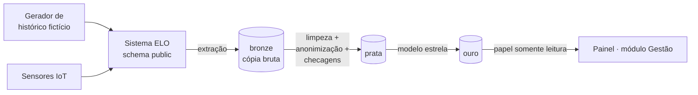

# Área 2 — Big Data e visualização

Os dados do ELO respondem a uma pergunta da coordenação do CRAS e da Secretaria de Assistência Social: **onde a rede de voluntários não está dando conta, e o que fazer?**

> Todos os dados são **fictícios**, gerados com semente fixa (reprodutíveis).

## Caminho do dado



| Camada | Schema | Conteúdo |
| --- | --- | --- |
| Operacional | `public` | O que o sistema grava: pedidos, triagem, ofertas, entregas, eventos dos sensores |
| **Bronze** | `bronze` | Cópia bruta de cada tabela, com a data da extração (`_extraido_em`). Nada é alterado |
| **Prata** | `prata` | Tipos corrigidos, duplicados removidos, tempos calculados e **dados pessoais removidos**: sem nome, CPF, telefone ou relato. Ids de pessoas viram hash irreversível com sal |
| **Ouro** | `ouro` | Modelo estrela + views e funções analíticas. É a única camada que o dashboard acessa |

### Modelo estrela (ouro)

| Tabela | Grão |
| --- | --- |
| `fato_solicitacao` | 1 pedido: canal, faixa, categoria, desfecho, escalado, origem da triagem, horas até a 1ª resposta e até o fechamento |
| `fato_entrega` | 1 entrega no ponto de coleta: origem (sensor/manual), kg, horas entre assumir e depositar |
| `fato_leitura_sensor` | 1 leitura de sensor: peso, temperatura, umidade |
| `fato_consumo_diario` | kg retirados por ponto e por dia |
| `dim_tempo`, `dim_bairro`, `dim_municipio`, `dim_ponto_coleta`, `dim_voluntario` | Dimensões (voluntário só como hash + bairro + ativo nos últimos 90 dias) |

## Ingestão e processamento

1. **Gerador** ([`pipeline/gerador.py`](pipeline/gerador.py)): simula 6 meses nos 2 municípios do seed: ~5.000 pedidos, ~5.100 pessoas, ~2.100 entregas e a telemetria diária dos pontos. As distribuições foram desenhadas para contar uma história:
   - o **Jardim São Pedro** tem poucos voluntários e muitos pedidos escalados ao CRAS;
   - pedidos de alimento aumentam no fim do mês;
   - há uma onda de calor de 7 dias nos sensores.
2. **Pipeline** ([`pipeline/etl.py`](pipeline/etl.py)): `public → bronze → prata → ouro`. Roda em ~5 s.
3. **Qualidade**: o pipeline **para antes da camada ouro** se encontrar coluna pessoal na prata, texto com formato de CPF, pedido sem faixa ou data de fechamento anterior à abertura.
4. **Funções analíticas** ([`sql/ouro_funcoes.sql`](sql/ouro_funcoes.sql)): recriadas a cada execução.

## Funções analíticas

| Objeto | O que calcula | Técnica |
| --- | --- | --- |
| `ouro.indicadores(inicio, fim, municipio, bairro, canal, categoria, faixa)` | Total, taxa de absorção pela rede, % escalado, % fora do app, horas até a 1ª resposta (geral e vermelha), % com desfecho | Agregação com `FILTER`, parâmetros opcionais |
| `ouro.v_pedidos_mensal` | Pedidos por mês e variação mês a mês | Janela `LAG` |
| `ouro.v_densidade_rede` | Voluntários ativos por 200 habitantes, por bairro | Razão por população |
| `ouro.v_territorio` | Pedidos por mil habitantes, % escalado, absorção e ranking de bairros | `RANK() OVER (PARTITION BY …)` |
| `ouro.v_previsao_estoque` | Dias até zerar o estoque de cada ponto | Média móvel de 7 dias (`ROWS BETWEEN 6 PRECEDING`) |
| `ouro.v_alertas_temperatura` | Dias com leitura acima de 30 °C por ponto | Agregação condicional |
| `ouro.v_canal_semanal`, `ouro.v_entregas`, `ouro.v_triagem` | Equidade por canal, sensor × manual, origem das decisões da triagem | Agregações |

Exemplo, na conta somente leitura:

```sql
SELECT * FROM ouro.indicadores(current_date - 90, current_date, p_canal => 'whatsapp');
SELECT bairro, pct_escalado, voluntarios_por_200_hab FROM ouro.v_territorio ORDER BY ranking_escalonamento;
```

## Segurança dos dados

- O dashboard conecta com o papel **`elo_leitura_ouro`**, que só tem `SELECT` na camada ouro. Tentar ler `public.usuario` resulta em `permission denied`, comprovado em teste automatizado.
- Pseudonimização com sal (`PIPELINE_SAL_HASH`), que permite contar pessoas distintas sem identificá-las.

## Como rodar

Com o `docker compose up -d` da raiz, o serviço `pipeline` gera o histórico (só na primeira vez) e roda a cada 15 minutos. Manualmente:

```bash
cd area2-dados
python -m venv .venv && .venv/Scripts/activate      # Windows (Linux/Mac: source .venv/bin/activate)
pip install -r requirements.txt
python -m pipeline.gerador            # gera o histórico fictício (use --forcar para recriar)
python -m pipeline.etl                # executa o pipeline
python -m pytest -v                   # testes (precisa de DATABASE_URL para os de integração)
```

> Os testes da API recriam o seed do banco e apagam o histórico gerado. Depois deles, rode `python -m pipeline.gerador --forcar` e `python -m pipeline.etl`.

## Dashboard

O dashboard é o módulo **Gestão** do painel web ([`../area3-mvp-iot/painel`](../area3-mvp-iot/painel)), com filtros de período, bairro, canal, categoria e faixa, lendo a API `/gestao/*`. A API usa só o papel somente leitura.
