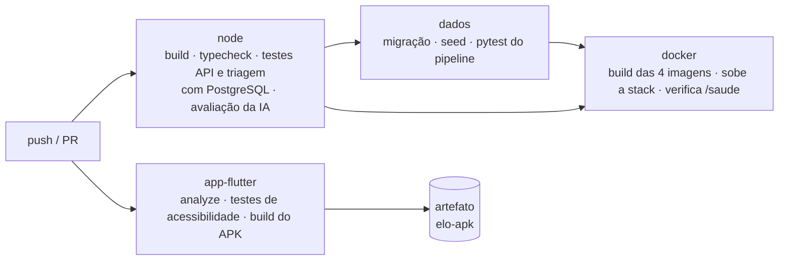

# Área 4 — DevOps, segurança e qualidade

## Organização

- Repositório Git no GitHub, organizado **por área** da Global Solution, como pede o desafio (veja o [README principal](../README.md#-estrutura)).
- Uma branch e um pull request por fase (`feat/fase-0-fundacao` … `feat/fase-6-entrega`), com um commit por funcionalidade e mensagens no padrão *Conventional Commits* (`feat`, `test`, `ci`, `docs`).
- Monorepo com pnpm workspaces (API, triagem e painel) + projeto Python (dados) + projeto Flutter (app).

## DevOps

### Docker Compose: a stack inteira com um comando

```bash
cp .env.example .env
docker compose up -d --build
docker compose ps
```

| Serviço | Imagem | Porta | O que faz |
| --- | --- | --- | --- |
| `db` | postgres:16-alpine | 5432 | Banco operacional + camadas bronze, prata e ouro |
| `api` | Node 22 (build do monorepo) | 3333 | Aplica migrações e o seed na subida. Healthcheck em `/saude` |
| `painel` | Next.js standalone | 3000 | Fila do técnico e dashboard de gestão |
| `pipeline` | Python 3.12 | — | Gera o histórico fictício (só na primeira vez) e roda o pipeline a cada 15 min |

A API só fica disponível depois que o banco está saudável, e o painel e o pipeline esperam a API (`depends_on` com `condition: service_healthy`).

### CI no GitHub Actions ([`.github/workflows/ci.yml`](../.github/workflows/ci.yml))

A cada push e pull request, sem nenhum passo manual:



### Rodar todos os testes localmente

```bash
docker compose up -d db
bash scripts/testar-tudo.sh      # salva as saídas em area4-devops/evidencias/
```

## Segurança

| # | Prática | Onde |
| --- | --- | --- |
| 1 | **Autenticação sem senha**: código de 6 dígitos de uso único, validade de 10 min, guardado como hash SHA-256. Não revela se o telefone existe | [`auth.controller.ts`](../area3-mvp-iot/api/src/auth/auth.controller.ts) |
| 2 | **JWT HS256** com expiração de 8 h e emissor verificado; **autorização por perfil** (cidadão, voluntário, técnico, gestor) em cada rota | [`sessao.ts`](../area3-mvp-iot/api/src/auth/sessao.ts), [`auth.guard.ts`](../area3-mvp-iot/api/src/auth/auth.guard.ts) |
| 3 | **Validação de toda entrada** com Zod, com erro 400 e mensagem em português | [`validacao.ts`](../area3-mvp-iot/api/src/infra/validacao.ts) |
| 4 | **Dispositivo IoT autenticado** por chave do ponto (hash + comparação em tempo constante) | [`iot.controller.ts`](../area3-mvp-iot/api/src/iot/iot.controller.ts) |
| 5 | **Proteção de dados (LGPD)**: mural sem endereço, nome ou relato; relato em tabela separada; faixa de risco nunca exibida ao cidadão; pedido vermelho nunca no mural | [`rede.controller.ts`](../area3-mvp-iot/api/src/rede/rede.controller.ts) |
| 6 | **Auditoria append-only**, inclusive de **leitura** do relato original | [`auditoria.ts`](../area3-mvp-iot/api/src/infra/auditoria.ts) |
| 7 | **Minimização antes do LLM**: nome, CPF, telefone, e-mail e endereço removidos do texto | [`minimizar.ts`](../area1-ia/triagem/src/minimizar.ts) |
| 8 | **Anonimização no pipeline** e **papel somente leitura** `elo_leitura_ouro` para o dashboard | [`etl.py`](../area2-dados/pipeline/etl.py), [`ouro_funcoes.sql`](../area2-dados/sql/ouro_funcoes.sql) |
| 9 | **Isolamento entre municípios**: todas as consultas filtram pelo município da sessão | Testes de isolamento |
| 10 | **Segredos fora do Git**: `.env` no `.gitignore`; só `.env.example` sem chaves é versionado | [`.gitignore`](../.gitignore) |

## Plano de testes

Execução registrada em [`evidencias/`](evidencias/) (gerado por `scripts/testar-tudo.sh`) e no CI.

| ID | Caso | Tipo | Resultado esperado | Arquivo | Status |
| --- | --- | --- | --- | --- | --- |
| **T1** | Relato com termo de violência | Unitário | Faixa vermelha **sem chamar o LLM**; não aparece no mural | `triagem.test.ts`, `rede-iot.test.ts` | ✅ |
| **T2** | LLM com erro, timeout ou confiança baixa | Unitário | Vermelha, vai para a fila do técnico (falha segura) | `triagem.test.ts` | ✅ |
| **T3** | Conjuntos rotulados de treino e validação | Integração | Recall da faixa vermelha = 100% | `triagem.test.ts` | ✅ |
| **T4** | Mural do bairro | Integração | Nenhum item com endereço, nome, telefone ou relato | `rede-iot.test.ts` | ✅ |
| **T5** | Protocolo inválido no ponto de coleta | Integração | 404 e o pedido não muda | `rede-iot.test.ts` | ✅ |
| **T6** | Depósito com peso acima do limiar | Integração | Pedido "entregue" e devolutiva "Sua ajuda chegou" | `rede-iot.test.ts` | ✅ |
| **T7** | Pipeline de dados | Integração | Nenhuma coluna pessoal em prata e ouro; checagens reprovam CPF e datas incoerentes | `test_pipeline.py` | ✅ |
| **T8** | Função `ouro.indicadores` | Integração | Taxa de absorção igual ao cálculo direto na camada prata | `test_pipeline.py` | ✅ |
| T9 | Permissões | Integração | Cidadão recebe 403 na fila do técnico; técnico de outro município não vê a fila | `solicitacoes.test.ts` | ✅ |
| T10 | Auditoria | Integração | Ler o relato gera evento `ler_relato` | `solicitacoes.test.ts` | ✅ |
| T11 | Reclassificação | Integração | Exige justificativa; histórico de classificação imutável | `solicitacoes.test.ts` | ✅ |
| T12 | Chave de dispositivo inválida | Integração | 401 | `rede-iot.test.ts` | ✅ |
| T13 | Escalonamento por SLA | Integração | Pedido verde sem voluntário vai ao CRAS | `rede-iot.test.ts` | ✅ |
| T14 | Papel somente leitura | Integração | Lê a camada ouro e recebe `permission denied` em `public.usuario` | `test_pipeline.py` | ✅ |
| T15 | Acessibilidade do app | Widget | Contraste, alvo de toque (Android e iOS) e rótulos dentro das guidelines | `widget_test.dart` | ✅ |
| T16 | App sem login social | Widget | Só gov.br e código por SMS | `widget_test.dart` | ✅ |

**Totais da última execução:** triagem 11 testes · API 24 testes · pipeline 9 testes · app 5 testes: **49 testes passando**.

### Roteiro de teste manual (leitor de tela)

1. Android: ative o **TalkBack**. Abra o app → "Receber código por SMS" → entre como Ana.
2. Navegue por gestos: cada atalho da tela Início deve ser anunciado com o nome ("Pedir ajuda, botão").
3. Em "Mapa da rede", confirme que a **lista** é a visão padrão e que cada item fala a distância e a direção.
4. Peça ajuda: o protocolo de 6 dígitos deve ser lido **dígito por dígito**.
5. No painel web, navegue só com o teclado (Tab/Shift+Tab): todo controle tem foco visível, e os gráficos têm o botão "Ver como tabela".
