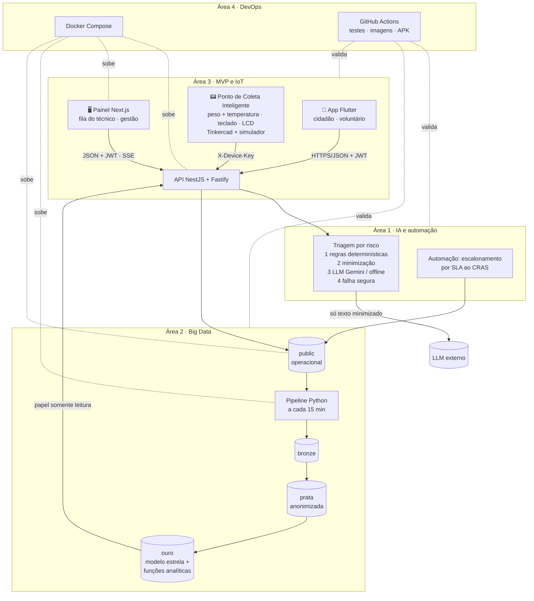
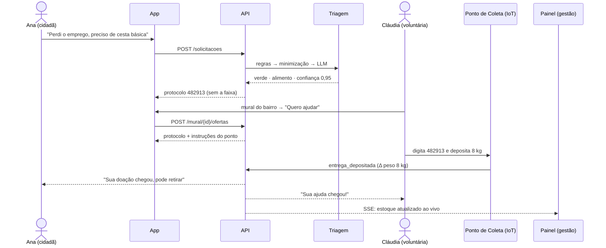
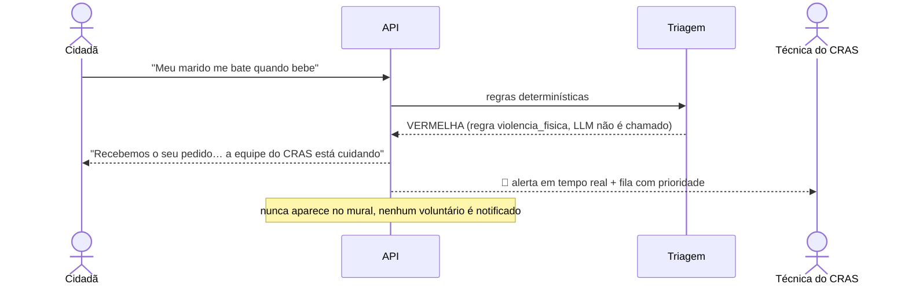

# Arquitetura do ELO

## Visão geral: as 4 áreas e como se conectam

## Integração entre as áreas

| De → para | O que passa | Por quê |
| --- | --- | --- |
| IoT → API → app | Evento `entrega_depositada` | A balança confirma a entrega e dispara "Sua ajuda chegou" |
| IoT → dados → dashboard | Leituras de peso e temperatura | Estoque ao vivo, previsão de dias até zerar, alertas de calor |
| IA → dados → dashboard | Origem e tempo de cada decisão da triagem + avaliações | Aba "Qualidade da IA" (IA medida) |
| Dados → IA | Relatos fictícios rotulados | Conjuntos de avaliação de treino e validação |
| IA → rede cidadã | Faixa e ponto de coleta sugerido | Verde vai ao mural; vermelho nunca é exposto |

## Fluxo principal (sequência)

## Contraprova: relato com indício de violência

## Tecnologias por área

| Área | Tecnologias |
| --- | --- |
| IA e automação | TypeScript, regras em JSON, Gemini via endpoint `/v1/chat/completions`, Vitest |
| Big Data | PostgreSQL 16 (schemas bronze/prata/ouro), Python, pandas, SQLAlchemy, Faker, SQL analítico, Apache ECharts |
| MVP e IoT | NestJS, Fastify, Zod, JWT, Next.js 16, Tailwind 4, Flutter, Arduino (Tinkercad), Python |
| DevOps | Git, GitHub, Docker, Docker Compose, GitHub Actions, pytest, flutter_test |
