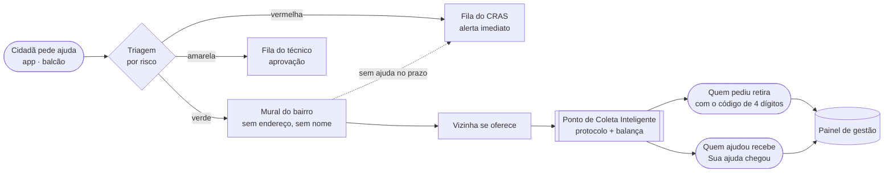
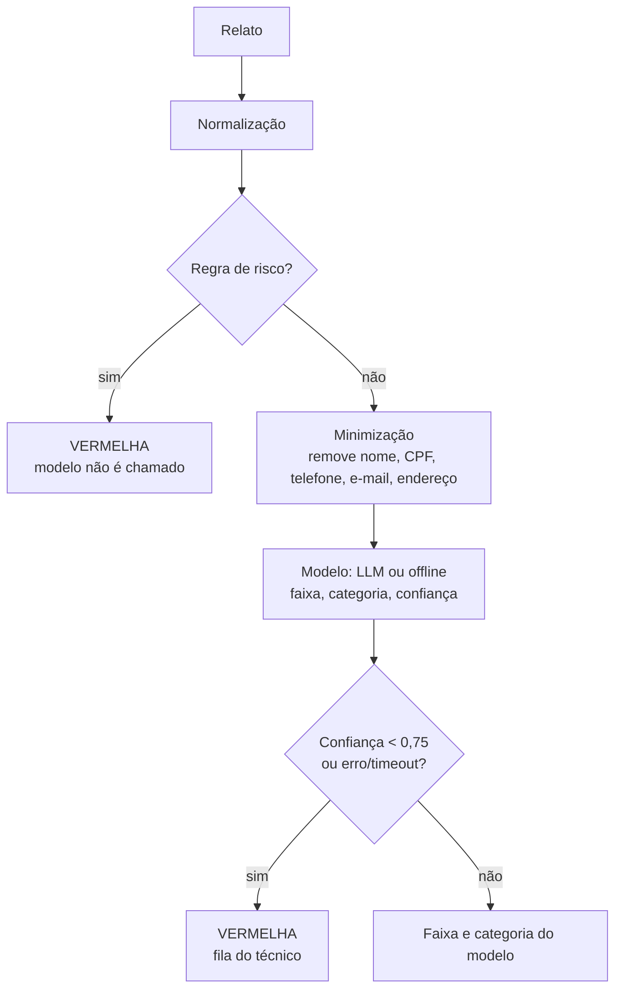

# ELO: plataforma municipal de mobilização solidária e triagem da demanda socioassistencial

> **Como usar este arquivo.** O texto já está pronto para passar para o modelo ABNT (NBR 14724, 6023, 6024, 6027 e 10520). Cada imagem aparece no ponto exato do texto onde deve entrar, num bloco assim:
>
> > **[FIGURA N]** título · **Arquivo:** caminho · **Status:** pronta / capturar / exportar · **Como obter:** instrução
>
> Na ABNT, o título vai **acima** da figura ("Figura N – Título") e a fonte vai **abaixo** ("Fonte: elaborado pelos autores (2026)."). As tabelas deste arquivo viram **Quadros** (texto) ou **Tabelas** (números), com título acima e fonte abaixo. No fim há o **Mapa de imagens** (Apêndice D), com a lista completa para conferir.
>
> Os campos entre colchetes, como `[preencher]`, dependem do grupo.

---

## Elementos pré-textuais

### Capa

- FIAP: Faculdade de Informática e Administração Paulista
- Engenharia de Software, 4º ano, turma 4ESOA
- Nome do grupo: `[preencher]`
- Integrantes (nome e RM): `[preencher, como em integrantes.txt]`
- **ELO: plataforma municipal de mobilização solidária e triagem da demanda socioassistencial**
- Global Solution 2026/2: CitizenTech
- São Paulo, 2026

> **[FIGURA 0, capa, sem numeração]** Logotipo do ELO · **Arquivo:** `images/elo-logo.png` (ou `images/elo-logo.svg`) · **Status:** pronta · **Como obter:** usar como está, centralizado acima do título.

### Folha de rosto

Mesmos dados da capa, mais a nota de natureza do trabalho:

> Trabalho apresentado à FIAP como requisito da Global Solution 2026/2 (tema CitizenTech), do curso de Engenharia de Software. Orientação: `[preencher, se houver]`.

### Resumo

A demanda que chega aos Centros de Referência de Assistência Social (CRAS) é maior do que a capacidade das equipes técnicas. Uma parte importante dela é material e de baixo risco (cesta básica, roupa, móvel, material escolar) e poderia ser atendida pela solidariedade do próprio bairro. Hoje, porém, quem quer ajudar não sabe quem precisa, e quem precisa não quer se expor. Este trabalho apresenta o ELO, uma plataforma municipal que liga essa solidariedade à rede pública de assistência social, com a prefeitura como fiadora da confiança.

Todo pedido passa por uma triagem por risco antes de ter qualquer visibilidade, em quatro etapas:

1. regras determinísticas;
2. remoção de dados pessoais;
3. modelo de linguagem;
4. falha segura.

O que a comunidade pode resolver vai ao mural do bairro, sem nome nem endereço. O que exige contato pessoal passa por aprovação técnica. O que indica violação de direitos vai direto à equipe do CRAS, com alerta, e nunca é exposto. As doações são entregues num Ponto de Coleta Inteligente, com balança, sensor de temperatura, teclado e visor, e a retirada exige um código que só quem pediu possui.

A solução integra quatro áreas:

- inteligência artificial, com triagem medida em conjuntos de treino e validação;
- dados, com pipeline bronze, prata e ouro, anonimização e um modelo estrela que alimenta o painel de gestão;
- MVP e IoT, com API, aplicativo Flutter, painel web e ponto de coleta simulado no Wokwi e no Tinkercad;
- DevOps, com Docker Compose, integração contínua no GitHub Actions e testes automatizados.

No conjunto de validação, que nunca foi usado para ajustar as regras, a triagem com LLM teve 100% de acurácia de faixa e 100% de recall na faixa vermelha. Ou seja, nenhum caso de risco foi parar no mural.

**Palavras-chave:** assistência social; triagem por risco; inteligência artificial; Internet das Coisas; voluntariado.

### Abstract

`[traduzir o resumo para o inglês]`

**Keywords:** social assistance; risk triage; artificial intelligence; Internet of Things; volunteering.

### Listas

Gerar automaticamente no editor: lista de figuras, lista de quadros e tabelas, lista de siglas (abaixo) e sumário.

**Lista de siglas**

| Sigla | Significado |
| --- | --- |
| API | Application Programming Interface |
| CadÚnico | Cadastro Único para Programas Sociais |
| CI | Integração contínua (Continuous Integration) |
| CRAS | Centro de Referência de Assistência Social |
| ETL | Extração, transformação e carga |
| IBGE | Instituto Brasileiro de Geografia e Estatística |
| IoT | Internet das Coisas |
| JWT | JSON Web Token |
| LGPD | Lei Geral de Proteção de Dados Pessoais |
| LLM | Modelo de linguagem de grande porte |
| ODS | Objetivos de Desenvolvimento Sustentável |
| SLA | Acordo de nível de serviço (prazo de atendimento) |
| SSE | Server-Sent Events |
| SUAS | Sistema Único de Assistência Social |

---

## 1 Introdução

O Sistema Único de Assistência Social (SUAS) organiza a proteção social no Brasil, e o CRAS é a porta de entrada dessa rede nos territórios (BRASIL, 1993; BRASIL, 2009). As equipes técnicas, formadas por assistentes sociais e psicólogos, são pequenas para a demanda que recebem. Muitos pedidos que chegam ao balcão não exigem um profissional de nível superior. Exigem um vizinho disponível com uma cesta básica, um colchão ou uma mochila. Esse tempo técnico gasto com demanda material é tempo que falta para os casos que só o CRAS pode atender, como violência doméstica, negligência ou risco à vida.

Ao mesmo tempo, existe muita solidariedade espalhada pelos bairros, mas ela é desorganizada. Quem quer ajudar não sabe quem precisa. E quem precisa tem bons motivos para não se expor em grupos de mensagens ou redes sociais.

**Objetivo geral.** Construir uma plataforma municipal que encaminhe cada pedido de ajuda ao destino certo, seja a rede de voluntários do bairro ou a equipe do CRAS, sem expor quem pede, e que dê à gestão municipal uma visão territorial da demanda.

**Objetivos específicos:**

1. classificar todo pedido por risco antes de qualquer exposição, com regras determinísticas antes do modelo de IA e falha segura;
2. conectar pedidos de baixo risco a voluntários do próprio território, sem nome, endereço ou relato;
3. confirmar a entrega das doações num ponto de coleta com sensores e proteger a retirada com um código que só quem pediu possui;
4. transformar os dados operacionais em indicadores de gestão anonimizados;
5. entregar a solução com implantação reproduzível, integração contínua e testes automatizados.

**Organização do trabalho.** A seção 2 apresenta o problema e o público. A seção 3 descreve a solução. A seção 4 descreve a arquitetura. As seções 5 a 8 detalham as quatro áreas técnicas. A seção 9 traz o fluxo de ponta a ponta. A seção 10 trata do impacto. A seção 11 traz as considerações finais.

---

## 2 Problema e público

### 2.1 O problema

`[Inserir aqui ao menos um dado oficial com fonte, por exemplo o número de famílias inscritas no CadÚnico no município escolhido, consultado no VIS Data/MDS, com citação no formato (BRASIL, ano) e entrada nas Referências.]`

O problema tem três lados:

- **Para o CRAS:** a demanda material de baixo risco ocupa a agenda técnica e atrasa a identificação dos casos graves.
- **Para quem precisa:** pedir ajuda em público expõe a pessoa a constrangimento e, em casos de violência, a risco real.
- **Para quem quer ajudar:** não há um canal confiável que diga o que levar, para onde e se a ajuda chegou.

### 2.2 Personas

| Persona | Papel | Necessidade |
| --- | --- | --- |
| Ana Paula, 34 anos, Jardim São Pedro | Cidadã que pede ajuda | Conseguir uma cesta básica sem se expor |
| Cláudia, 52 anos, Vila Nova | Moradora que ajuda | Saber o que levar, onde entregar e se a ajuda chegou |
| Fernanda, assistente social do CRAS | Técnica | Ver primeiro os casos de risco, com alerta |
| Secretaria de Assistência Social | Gestão | Saber onde a rede não dá conta e onde recrutar voluntários |
| Agente do ponto de coleta | Equipe do ponto | Registrar o que chegou e quem retirou |

Todas as pessoas e todos os dados do projeto são **fictícios**.

---

## 3 Solução

### 3.1 Visão geral

O ELO conecta a solidariedade do bairro à rede pública de assistência social. A ideia central é que **todo pedido é classificado por risco antes de ter qualquer visibilidade**:

- **Faixa verde**, que a comunidade pode resolver: o pedido vai ao mural do bairro, sem nome, endereço ou relato.
- **Faixa amarela**, que exige contato pessoal: o pedido passa pela aprovação de um técnico.
- **Faixa vermelha**, com indício de violação de direitos: o pedido vai direto à equipe do CRAS, com alerta em tempo real, e **nunca** aparece no mural.

Quem pede nunca vê a faixa de risco. A pessoa recebe só a mensagem "Recebemos o seu pedido" e um protocolo de 6 dígitos, que dá para falar ao telefone e anotar em papel.

> **[FIGURA 1]** Representação das telas do ELO · **Arquivo:** `images/representacao das telas elo.png` · **Status:** pronta · **Como obter:** usar como está.

> **[FIGURA 2]** Fluxo geral do ELO, do pedido à devolutiva · **Arquivo:** `docs/figuras/fig02-fluxo-geral.png` · **Status:** exportar · **Como obter:** colar o diagrama abaixo em mermaid.live e exportar em PNG.



### 3.2 Ecossistema e perfis

| Perfil | Onde usa | O que faz |
| --- | --- | --- |
| Cidadão | Aplicativo | Pede ajuda, se oferece para ajudar outras pessoas, conversa com quem está ajudando, acompanha os próprios pedidos |
| Técnico do CRAS | Painel web | Fila de casos com alerta, ficha do pedido com leitura auditada, reclassificação e desfecho |
| Gestor municipal | Painel web | Painel de gestão com 5 abas, locais da rede (pontos de coleta, abrigos e outros) e equipe |
| Agente do ponto de coleta | Painel web | Recebe a doação pelo protocolo, registra a retirada com o código e consulta o registro de movimentações |
| Ponto de Coleta Inteligente | Dispositivo IoT | Confirma o depósito pelo peso, monitora a temperatura e aceita a retirada com código |

Uma mesma conta de cidadão pode pedir e ajudar. Não há escolha de perfil na criação da conta.

### 3.3 Funcionalidades do aplicativo

- **Início com a localização do aparelho:** com permissão, mostra os pedidos próximos (raio de 30 km), com banners, atalhos e a distância de cada pedido.
- **Mapa da rede:** mostra o ponto "Você está aqui" com zoom no entorno, os locais da rede e os pedidos agregados por bairro. Tem também uma visão em lista, mais acessível.
- **Pedir ajuda:** relato livre e itens. O protocolo aparece na confirmação.
- **Quero ajudar:** a pessoa escolhe os itens e recebe as instruções do ponto de coleta e o protocolo.
- **Mensagens:** a aba **Conversas** tem a conversa entre quem pediu e quem ajuda. A aba **Notificações do sistema** traz os avisos da plataforma, como "Sua ajuda chegou" e "Sua doação está no ponto".
- **Retirada segura:** quem pediu recebe um código de 4 dígitos, visível só para essa pessoa, que é exigido na retirada.
- **Privacidade:** a pessoa aceita a Política de Privacidade e os Termos de Uso ao criar a conta, e os dois ficam disponíveis no Perfil. A conta pode ser excluída: os dados pessoais são apagados, o histórico é anonimizado, os pedidos abertos são cancelados e as ofertas são desativadas.
- **Conta simples:** a pessoa entra com um código enviado por e-mail ou com a conta Google, e pode ativar a verificação em duas etapas. A conta é criada sem escolher bairro, que é deduzido da localização do aparelho.

---

## 4 Arquitetura

### 4.1 Visão geral

A solução é um monorepo organizado pelas quatro áreas da Global Solution. Uma API central (NestJS sobre Fastify) atende três clientes: o aplicativo Flutter, o painel web Next.js e o Ponto de Coleta Inteligente. O PostgreSQL guarda os dados operacionais no schema `public` e as camadas analíticas nos schemas `bronze`, `prata` e `ouro`.

> **[FIGURA 3]** Arquitetura do ELO e integração entre as quatro áreas · **Arquivo:** `docs/figuras/fig03-arquitetura.png` · **Status:** exportar · **Como obter:** exportar em mermaid.live o primeiro diagrama de `docs/ARQUITETURA.md` (seção "Visão geral").

### 4.2 Integração entre as áreas

| De → para | O que passa | Para quê |
| --- | --- | --- |
| IoT → API → app | Eventos `entrega_depositada` e `retirada` | A balança confirma a entrega e dispara "Sua ajuda chegou" |
| IoT → dados → gestão | Leituras de peso e temperatura | Estoque ao vivo, previsão de dias até zerar e alertas de calor |
| IA → dados → gestão | Origem e tempo de cada decisão da triagem | Aba "Qualidade da IA" do painel |
| Dados → IA | Relatos fictícios rotulados | Conjuntos de treino e validação |
| IA → rede cidadã | Faixa de risco | O verde vai ao mural, o vermelho nunca é exposto |

### 4.3 Tecnologias

| Camada | Tecnologia |
| --- | --- |
| API | Node.js 22, NestJS sobre Fastify, Zod, `pg`, JWT |
| Triagem | TypeScript, regras em JSON versionado, LLM Gemini por endpoint `/v1/chat/completions`, classificador offline |
| Banco | PostgreSQL 16, 15 migrações SQL versionadas |
| Dados | Python, pandas, SQLAlchemy, Faker |
| Painel web | Next.js 16, Tailwind, Apache ECharts |
| Aplicativo | Flutter (Android, iOS e web) |
| IoT | Arduino Uno no Wokwi e no Tinkercad, simulador e ponte serial em Python |
| DevOps | Git, GitHub, Docker Compose, GitHub Actions, Vitest, pytest, flutter_test |

---

## 5 Área 1: IA e automação (triagem por risco)

### 5.1 Funcionamento

A triagem decide o destino de cada pedido, em quatro etapas:

1. **Regras determinísticas:** 11 regras versionadas em `lexico.json` cobrem violência, abuso, ameaça, risco à vida, criança ou idoso em risco, fome aguda, situação de rua, trabalho infantil e outros casos. Qualquer acerto força a faixa vermelha **sem consultar o modelo**.
2. **Minimização:** nome, CPF, telefone, e-mail e endereço são removidos do texto antes de qualquer modelo, como pede a LGPD (BRASIL, 2018).
3. **Modelo:** o LLM, ou o classificador offline quando não há LLM configurado, devolve uma saída estruturada com faixa, categoria, confiança e justificativa.
4. **Falha segura:** confiança abaixo de 0,75, erro, tempo esgotado ou resposta inválida levam o pedido para a faixa vermelha, na fila do técnico.

O princípio é **"na dúvida, escalar; nunca expor"**. Um falso positivo custa tempo do técnico. Um falso negativo pode custar uma pessoa.

> **[FIGURA 4]** Etapas da triagem por risco · **Arquivo:** `docs/figuras/fig04-triagem.png` · **Status:** exportar · **Como obter:** exportar o diagrama abaixo em mermaid.live.



### 5.2 Prompt

O prompt completo está em `area1-ia/triagem/src/prompt.ts` e em `area1-ia/README.md`. Incluir no corpo do trabalho como **Quadro**. A versão 2 explica o que é a faixa vermelha e traz três exemplos. Com a versão 1, que dizia apenas "na dúvida, escolha a mais grave", o modelo classificava pedidos comuns de cesta básica como vermelhos ("risco de fome aguda").

### 5.3 Exemplos de entrada e saída

| Relato (fictício) | Faixa | Categoria | Origem |
| --- | --- | --- | --- |
| "Perdi o emprego e preciso de uma cesta básica para meus dois filhos" | verde | alimento | modelo |
| "Sou idosa, moro sozinha e preciso de alguém para me ajudar a carregar o botijão" | amarela | apoio ao idoso | modelo |
| "Meu marido me bate quando bebe e eu tenho medo de ficar em casa" | vermelha | — | regra `violencia_fisica` |

> **[FIGURA 5]** Fila do técnico do CRAS, com o caso vermelho em destaque · **Arquivo:** `docs/prints/painel-02-fila.png` · **Status:** pronta. Conferir só se o menu lateral já mostra "Retirar" e "Registro"; se não mostrar, recapturar com o mesmo nome.

> **[FIGURA 6]** Ficha do pedido: relato, histórico de classificação e reclassificação · **Arquivo:** `docs/prints/painel-03-ficha.png` · **Status:** pronta, com a mesma conferência do menu.

### 5.4 Avaliação

Os dois conjuntos foram rotulados à mão pelo grupo, com dados fictícios:

- **Treino:** 60 relatos (30 verdes, 15 amarelos e 15 vermelhos), usados para escrever e ajustar as regras.
- **Validação:** 20 relatos escritos depois e **nunca usados para ajustar regras**, para medir se a triagem generaliza.

**Tabela 1 – Resultados da triagem**

| Versão | Conjunto | Acurácia da faixa | Recall da vermelha | Falsos negativos de vermelha |
| --- | --- | --- | --- | --- |
| Léxico v1 | treino | 95,0% | 86,7% | 2 |
| Léxico v2 | treino | 100,0% | 100,0% | 0 |
| Léxico v2 + classificador offline | validação | 90,0% | 100,0% | 0 |
| Léxico v2 + Gemini 3.5 Flash-Lite (prompt v2) | treino | 100,0% | 100,0% | 0 |
| Léxico v2 + Gemini 3.5 Flash-Lite (prompt v2) | validação | 100,0% | 100,0% | 0 |

Fonte: `area1-ia/triagem/avaliacao/resultado*.md`.

**Antes e depois.** A versão 1 do léxico deixou passar dois casos de risco: "companheiro não deixa eu sair de casa" e "menino vendendo no farol". As duas regras foram ampliadas na versão 2. Na validação com o classificador offline, os dois erros que restaram foram para o lado seguro (um verde enviado ao técnico por baixa confiança) ou não envolviam risco (um amarelo classificado como verde).

**Ganho de tempo.** A triagem automática leva menos de 1 ms por relato com o classificador offline e entre 0,5 e 1,5 s com o LLM. Triagem manual cronometrada: `[preencher: um integrante classifica os 20 relatos de validação e registra o tempo médio]`.

**Limitação.** Os conjuntos são pequenos e foram escritos pelo grupo. Em produção, deveriam ser rotulados por assistentes sociais e revisados periodicamente.

> **[FIGURA 7]** Aba "Qualidade da IA" do painel de gestão · **Arquivo:** `docs/prints/painel-08-gestao-ia.png` · **Status:** pronta.

### 5.5 Automação

Além da triagem, o sistema **escalona por SLA**. Um pedido verde que ninguém assume no prazo vai automaticamente para a fila do CRAS, para que nenhum pedido fique esquecido no mural.

---

## 6 Área 2: Big Data e visualização

### 6.1 Pergunta de negócio

Os dados respondem a uma pergunta da coordenação do CRAS e da Secretaria: **onde a rede de voluntários não está dando conta, e o que fazer?**

### 6.2 Caminho do dado

| Camada | Schema | Conteúdo |
| --- | --- | --- |
| Operacional | `public` | Pedidos, triagem, ofertas, entregas, retiradas e leituras dos sensores |
| Bronze | `bronze` | Cópia bruta de cada tabela, com a data da extração |
| Prata | `prata` | Tipos corrigidos, duplicados removidos, tempos calculados e **sem dados pessoais** (ids de pessoas viram hash irreversível com sal) |
| Ouro | `ouro` | Modelo estrela, views e funções analíticas; única camada que o painel de gestão lê |

> **[FIGURA 8]** Camadas do pipeline de dados (bronze, prata e ouro) · **Arquivo:** `docs/figuras/fig08-camadas-dados.png` · **Status:** exportar · **Como obter:** exportar em mermaid.live o diagrama de `area2-dados/README.md` (seção "Caminho do dado").

### 6.3 Ingestão e processamento

1. **Gerador** (`pipeline/gerador.py`): simula seis meses nos dois municípios de demonstração, com cerca de 5.000 pedidos, 5.100 pessoas, 2.100 entregas e a telemetria diária dos pontos. As distribuições contam uma história: o Jardim São Pedro tem poucos voluntários e muitos pedidos escalados; os pedidos de alimento crescem no fim do mês; e há uma onda de calor de sete dias.
2. **Pipeline** (`pipeline/etl.py`): faz `public → bronze → prata → ouro` em cerca de 5 s e roda a cada 15 minutos.
3. **Qualidade:** o pipeline **para antes da camada ouro** se encontrar qualquer um destes problemas na prata:
   - coluna pessoal;
   - texto no formato de CPF;
   - pedido sem faixa;
   - data de fechamento anterior à abertura.

### 6.4 Modelo estrela

| Tabela | Grão |
| --- | --- |
| `fato_solicitacao` | Um pedido: canal, faixa, categoria, desfecho, escalonamento, origem da triagem, horas até a primeira resposta e até o fechamento |
| `fato_entrega` | Uma entrega no ponto: origem (sensor ou manual), quilos, horas entre assumir e depositar |
| `fato_leitura_sensor` | Uma leitura: peso, temperatura, umidade |
| `fato_consumo_diario` | Quilos retirados por ponto e por dia |
| `dim_tempo`, `dim_bairro`, `dim_municipio`, `dim_ponto_coleta`, `dim_voluntario` | Dimensões (o voluntário aparece só como hash, bairro e atividade nos últimos 90 dias) |

> **[FIGURA 9, opcional]** Diagrama do modelo estrela · **Arquivo:** `docs/figuras/fig09-modelo-estrela.png` · **Status:** capturar · **Como obter:** gerar o diagrama ER do schema `ouro`, por exemplo no DBeaver em "Diagrama ER", com a stack rodando. Se não houver tempo, manter só a tabela acima como Quadro.

### 6.5 Funções analíticas

| Objeto | O que calcula | Técnica |
| --- | --- | --- |
| `ouro.indicadores(...)` | Total, absorção pela rede, % escalado, % fora do app, horas até a primeira resposta | Agregação com `FILTER` e parâmetros opcionais |
| `ouro.v_pedidos_mensal` | Pedidos por mês e variação mês a mês | Janela `LAG` |
| `ouro.v_densidade_rede` | Voluntários ativos por 200 habitantes, por bairro | Razão por população |
| `ouro.v_territorio` | Pedidos por mil habitantes, % escalado e ranking de bairros | `RANK() OVER (PARTITION BY ...)` |
| `ouro.v_previsao_estoque` | Dias até zerar o estoque de cada ponto | Média móvel de 7 dias |
| `ouro.v_alertas_temperatura` | Dias acima de 30 °C por ponto | Agregação condicional |

O SQL completo está em `area2-dados/sql/ouro_funcoes.sql` e pode entrar como apêndice.

### 6.6 Painel de gestão

O painel de gestão é um módulo do painel web. Ele tem filtros de período, bairro, canal, categoria e faixa, e cada gráfico tem o botão "Ver como tabela", por acessibilidade. O painel acessa o banco com o papel `elo_leitura_ouro`, que só tem permissão de leitura na camada ouro. Uma tentativa de ler `public.usuario` com esse papel recebe `permission denied`, o que é comprovado em teste automatizado.

> **[FIGURA 10]** Painel de gestão: visão geral · **Arquivo:** `docs/prints/painel-04-gestao-visao-geral.png` · **Status:** pronta.

> **[FIGURA 11]** Painel de gestão: equidade por canal · **Arquivo:** `docs/prints/painel-05-gestao-equidade.png` · **Status:** pronta.

> **[FIGURA 12]** Painel de gestão: território (ranking de bairros e densidade da rede) · **Arquivo:** `docs/prints/painel-06-gestao-territorio.png` · **Status:** pronta.

> **[FIGURA 13]** Painel de gestão: pontos de coleta (estoque, previsão e temperatura) · **Arquivo:** `docs/prints/painel-07-gestao-pontos.png` · **Status:** pronta.

> **[FIGURA 14]** Filtro aplicado (canal WhatsApp) e gráfico exibido como tabela · **Arquivo:** `docs/prints/painel-09-filtro-whatsapp-tabela.png` · **Status:** pronta.

---

## 7 Área 3: MVP, IoT e experiência digital

### 7.1 Aplicativo (cidadão)

O aplicativo foi feito em Flutter e roda em Android, iOS e web, seguindo o design system próprio do ELO. A acessibilidade é coberta por testes: contraste, tamanho mínimo de alvo de toque e rótulos para leitor de tela.

> **[FIGURA 15]** Boas-vindas e entrada, com o painel branco arredondado sobre a foto · **Arquivo:** `docs/prints/app-01-boas-vindas.png` · **Status:** **recapturar** (o print atual é de antes do painel arredondado).

> **[FIGURA 16]** Início: saudação, banners, atalhos e pedidos próximos pela localização · **Arquivo:** `docs/prints/app-02-inicio-cidada.png` · **Status:** **recapturar** (o Início foi refeito com os banners).

> **[FIGURA 17]** Mapa da rede com "Você está aqui" e zoom na região · **Arquivo:** `docs/prints/app-04-mapa.png` · **Status:** **recapturar**.

> **[FIGURA 18]** Mapa da rede em lista (visão acessível) · **Arquivo:** `docs/prints/app-05-lista.png` · **Status:** recapturar se o visual mudou.

> **[FIGURA 19]** Detalhe de um pedido ("Precisa de...", pessoas ajudando) · **Arquivo:** `docs/prints/app-06-pedido.png` · **Status:** **recapturar** (o card do pedido mudou).

> **[FIGURA 20]** Pedir ajuda · **Arquivo:** `docs/prints/app-07-pedir-ajuda.png` · **Status:** recapturar se o visual mudou.

> **[FIGURA 21]** Confirmação com protocolo e código de retirada · **Arquivo:** `docs/prints/app-11-confirmacao-codigo.png` · **Status:** **capturar** (nova).

> **[FIGURA 22]** Quero ajudar: itens e instruções do ponto de coleta · **Arquivo:** `docs/prints/app-08-quero-ajudar.png` · **Status:** recapturar se o visual mudou.

> **[FIGURA 23]** Mensagens: Conversas e Notificações do sistema · **Arquivo:** `docs/prints/app-10-mensagens.png` · **Status:** **recapturar** (a aba Notificações do sistema é nova).

> **[FIGURA 24]** Conversa entre quem pediu e quem ajuda · **Arquivo:** `docs/prints/app-12-conversa.png` · **Status:** **capturar** (nova).

> **[FIGURA 25]** Notificação "Sua ajuda chegou" · **Arquivo:** `docs/prints/app-09-sua-ajuda-chegou.png` · **Status:** recapturar se o visual mudou.

> **[FIGURA 26]** Criar conta com aceite dos Termos de Uso e da Política de Privacidade · **Arquivo:** `docs/prints/app-13-criar-conta-termos.png` · **Status:** **capturar** (nova).

> **[FIGURA 27]** Perfil: seção Privacidade (documentos legais e excluir conta) · **Arquivo:** `docs/prints/app-14-perfil-privacidade.png` · **Status:** **capturar** (nova).

> **[FIGURA 28, opcional]** Confirmação da exclusão de conta · **Arquivo:** `docs/prints/app-15-excluir-conta.png` · **Status:** capturar.

### 7.2 Painel web (equipe)

O painel web, em Next.js, atende técnicos, gestores e agentes dos pontos de coleta. As telas são:

- entrada;
- fila do CRAS;
- ficha do pedido;
- painel de gestão, com 5 abas;
- locais da rede;
- equipe;
- receber doação;
- retirar doação;
- registro de movimentações.

> **[FIGURA 29]** Entrada no painel · **Arquivo:** `docs/prints/painel-01-login.png` · **Status:** pronta.

> **[FIGURA 30]** Receber doação pelo protocolo · **Arquivo:** `docs/prints/painel-10-receber.png` · **Status:** **capturar** (nova).

> **[FIGURA 31]** Retirar doação, com protocolo e código de retirada · **Arquivo:** `docs/prints/painel-11-retirar.png` · **Status:** **capturar** (nova).

> **[FIGURA 32]** Registro das entregas e retiradas (log) · **Arquivo:** `docs/prints/painel-12-registro.png` · **Status:** **capturar** (nova).

### 7.3 API

A API, em NestJS sobre Fastify, concentra as regras de negócio. Ela cuida de:

- login sem senha, por código no e-mail ou pela conta Google;
- pedidos com triagem;
- mural com filtro por distância;
- ofertas e conversas;
- entregas e retiradas;
- eventos dos dispositivos;
- fila técnica com tempo real (SSE);
- painel de gestão.

A tabela completa de rotas está em `area3-mvp-iot/README.md` e pode entrar como apêndice.

### 7.4 IoT: Ponto de Coleta Inteligente

A doação é entregue **sempre num ponto de coleta**, nunca na casa de quem pediu. O ponto não capta nenhum dado pessoal, só peso, temperatura e o número do protocolo.

| Componente | Função | Pino (Arduino Uno) |
| --- | --- | --- |
| Sensor 1: balança (potenciômetro no Wokwi, FSR no Tinkercad, célula de carga com HX711 no hardware real) | Detecta o depósito e mede o estoque | A0 |
| Sensor 2: temperatura (NTC no Wokwi, TMP36 no Tinkercad) | Conservação dos alimentos | A1 |
| Teclado 4×4 | Protocolo, código de retirada e comandos | 9, 8, 7, 6 / 5, 4, 3, 2 |
| LCD 16×2 I2C | Mensagens ao usuário | SDA A4 / SCL A5 |
| LED vermelho com resistor de 220 Ω | Alerta de calor ou de estoque baixo | 10 |
| Buzzer | Bipe de confirmação e de alerta | 11 |

**Funcionamento:**

- **Entrega:** a voluntária digita o protocolo e `#` e deposita a doação. Depois de 3 s de peso estável, o visor mostra "Entrega OK!" e a API avisa quem pediu e quem ajudou.
- **Retirada:** quem pediu digita `B`, o protocolo e o código de 4 dígitos. O visor mostra o código como `****`, e a API confere o código e conclui o pedido. Depois de 5 códigos errados, a retirada fica bloqueada por 1 hora.
- **Alertas:** temperatura acima de 30 °C ou estoque abaixo de 15% acendem o LED e tocam o buzzer.

O dispositivo se autentica com a chave do ponto no cabeçalho `X-Device-Key`. A API guarda só o hash da chave e faz a comparação em tempo constante. Como o Arduino simulado não tem rede, o simulador em Python envia à API exatamente as mesmas mensagens JSON que o sketch imprime no Serial. Com hardware real, a ponte serial faz esse repasse.

> **[FIGURA 33]** Circuito do Ponto de Coleta Inteligente no Wokwi · **Arquivo:** `area3-mvp-iot/iot/wokwi/circuito.png` · **Status:** pronta. Abaixo da figura, colocar o **link público da simulação no Wokwi** `[preencher após Save/Share]`.

> **[FIGURA 34]** Visor do ponto, numa figura com 4 partes: (a) início, (b) "Entrega OK!", (c) código de retirada oculto, (d) "Retirada enviada" · **Arquivos:** `area3-mvp-iot/iot/wokwi/telas/1-inicio.png`, `2-entrega-ok.png`, `3-codigo-oculto.png` e `4-retirada-enviada.png` · **Status:** prontas · **Como obter:** montar as quatro lado a lado numa figura só, com as legendas (a) a (d).

> **[FIGURA 35, opcional]** Circuito equivalente no Tinkercad · **Arquivo:** `docs/figuras/fig35-tinkercad.png` · **Status:** capturar, se o grupo montar o circuito no Tinkercad.

O teste automático pelo Wokwi CLI liga o ponto, faz uma entrega e uma retirada e confere as linhas JSON do Serial:

```
{"tipo":"leitura_sensor","peso_kg":87.98,"temperatura_c":24.0}
{"tipo":"entrega_depositada","protocolo":"204815","delta_peso_kg":92.08,"peso_kg":180.06,"temperatura_c":24.0}
{"tipo":"retirada","protocolo":"204815","codigo":"4821","delta_peso_kg":0,"peso_kg":180.06}
```

---

## 8 Área 4: DevOps, segurança e qualidade

### 8.1 Organização e implantação

O repositório Git fica no GitHub, organizado por área. Cada fase tem uma branch e um pull request, e os commits seguem o padrão Conventional Commits. A stack inteira sobe com um comando:

```bash
cp .env.example .env
docker compose up -d --build
```

| Serviço | Porta | Função |
| --- | --- | --- |
| `db` (PostgreSQL 16) | 5432 | Banco operacional e camadas analíticas |
| `api` (Node 22) | 3333 | Aplica as migrações na subida; verificação de saúde em `/saude` |
| `painel` (Next.js) | 3000 | Painel da equipe |
| `pipeline` (Python 3.12) | — | Gera o histórico fictício e roda o ETL a cada 15 minutos |

> **[FIGURA 36]** Serviços em execução (`docker compose ps`) · **Arquivo:** `docs/figuras/fig36-docker-compose-ps.png` · **Status:** **capturar** · **Como obter:** print do terminal após `docker compose up -d` e `docker compose ps`, com os serviços "healthy".

### 8.2 Integração contínua

A cada push e pull request, o GitHub Actions faz, sem nenhum passo manual:

- o build e a checagem de tipos;
- os testes da API e da triagem, com PostgreSQL;
- a avaliação da IA;
- os testes do pipeline;
- a análise e os testes de acessibilidade do app;
- o build do APK;
- o build das imagens Docker, subindo a stack e verificando a saúde.

> **[FIGURA 37]** Pipeline de CI (jobs e dependências) · **Arquivo:** `docs/figuras/fig37-ci.png` · **Status:** exportar · **Como obter:** exportar em mermaid.live o diagrama de `area4-devops/README.md` (seção "CI no GitHub Actions").

> **[FIGURA 38]** Execução verde no GitHub Actions, com o artefato `elo-apk` · **Arquivo:** `docs/figuras/fig38-actions-verde.png` · **Status:** **capturar** · **Como obter:** print da aba Actions do repositório, numa execução concluída, mostrando os jobs e o artefato.

### 8.3 Segurança e LGPD

| Prática | Como foi feita |
| --- | --- |
| Autenticação sem senha | Código de 6 dígitos de uso único, válido por 10 minutos e guardado como hash, enviado por e-mail; ou conta Google, com o token conferido; verificação em duas etapas opcional |
| Sessão e autorização | JWT com expiração de 8 h; perfil checado em cada rota; conta excluída perde o acesso na hora |
| Validação de entrada | Zod em todas as rotas, inclusive na rota IoT |
| Dispositivo IoT | Chave do ponto guardada como hash e comparada em tempo constante |
| Minimização | Mural sem nome, endereço ou relato; faixa de risco nunca exibida; texto minimizado antes do LLM |
| Retirada | Código de 4 dígitos visível só para quem pediu; 5 erros bloqueiam por 1 hora; tudo vai para o registro |
| Auditoria | Registro append-only, inclusive da **leitura** do relato pelo técnico |
| Dados analíticos | Anonimização no pipeline e papel somente leitura na camada ouro |
| Isolamento entre municípios | Toda consulta da equipe filtra pelo município da sessão, com teste automatizado |
| Direitos do titular | Termos e Política aceitos na criação da conta (com versão registrada); exclusão de conta com anonimização |
| Segredos | `.env` fora do Git; só o `.env.example`, sem chaves, é versionado |

**Auditoria de segurança.** Em 19/11/2026, o código passou por uma auditoria automatizada com a skill aberta *security-audit* da Cloudflare, no perfil rápido. A auditoria só leu o código e rodou checagens locais numa sandbox sem rede, com contas e dados fictícios. Ela confirmou:

- 2 achados de severidade alta: a ausência de limite de tentativas no código de login e o modo de demonstração ligado por padrão;
- 1 achado de severidade média: oferta de voluntário que continua ativa depois que o pedido é reclassificado para uma faixa de risco;
- 5 achados de severidade baixa.

Todos vieram com a correção indicada. `[Atualizar este parágrafo com as correções aplicadas antes da entrega.]`

> **[FIGURA 39, opcional]** Tabela de achados da auditoria de segurança · **Status:** opcional · **Como obter:** usar como Quadro a tabela da seção 3 do relatório da auditoria, em vez de imagem.

### 8.4 Plano de testes

| ID | Caso | Resultado esperado |
| --- | --- | --- |
| T1 | Relato com termo de violência | Faixa vermelha sem chamar o LLM; não aparece no mural |
| T2 | LLM com erro, tempo esgotado ou confiança baixa | Faixa vermelha, na fila do técnico |
| T3 | Conjuntos rotulados | Recall de 100% na faixa vermelha |
| T4 | Mural | Nenhum item com endereço, nome, telefone ou relato |
| T5 | Protocolo inválido no ponto | 404, e o pedido não muda |
| T6 | Depósito acima do limiar de peso | Pedido entregue e devolutiva "Sua ajuda chegou" |
| T7 | Pipeline | Nenhuma coluna pessoal na prata nem na ouro |
| T8 | `ouro.indicadores` | Absorção igual ao cálculo direto na prata |
| T9 | Permissões | Cidadão recebe 403 na fila técnica; técnico de outro município não a vê |
| T10 | Auditoria | Ler o relato gera o evento `ler_relato` |
| T11 | Reclassificação | Exige justificativa; histórico imutável |
| T12 | Chave de dispositivo inválida | 401 |
| T13 | Escalonamento por SLA | Pedido verde sem voluntário vai ao CRAS |
| T14 | Papel somente leitura | Lê a camada ouro e recebe `permission denied` em `public` |
| T15 | Acessibilidade do app | Contraste, alvo de toque e rótulos dentro das diretrizes |
| T16 | Login | Entra com e-mail + código; e-mail desconhecido não revela a conta; fora do modo demonstração o código nunca vem na resposta; Google recusa token de outro aplicativo |
| T17 | Retirada com código | Só quem pediu vê o código; não retira o que não chegou; 5 erros bloqueiam por 1 hora |
| T18 | Registro (log) | Entrega, retirada e código errado ficam salvos, com quem registrou e onde |
| T19 | Conversas, termos e exclusão de conta | Ninguém de fora lê a conversa; criar conta exige aceitar os termos; excluir a conta apaga os dados e encerra a sessão |
| T20 | Localização do aparelho | Posição vira cidade e bairro; o bairro novo ganha posição aproximada (~1 km); "Mais perto de mim" usa a posição |
| T21 | Agente do ponto | Vê só o primeiro nome de quem ajuda; protocolo de outra cidade diz de qual cidade é |

**Totais da última execução no CI (`main`, 19/11/2026):** 11 testes da triagem, 143 da API, 9 do pipeline e 24 do app, num total de 187 testes passando. As saídas ficam em `area4-devops/evidencias/` e podem entrar como apêndice.

> **[FIGURA 40, opcional]** Saída dos testes no terminal · **Arquivo:** `docs/figuras/fig40-testes.png` · **Status:** capturar · **Como obter:** print do final de `bash scripts/testar-tudo.sh`.

---

## 9 Fluxo de ponta a ponta

1. **Ana**, no app, pede ajuda: "Perdi o emprego, preciso de uma cesta básica para meus dois filhos". A triagem classifica como verde e alimento. Ela recebe o protocolo de 6 dígitos e o código de retirada de 4 dígitos.
2. O pedido aparece no **mural** para quem está por perto, sem nome nem endereço.
3. **Cláudia** toca em "Quero ajudar", escolhe os itens e recebe o protocolo e as instruções do ponto. As duas podem conversar pela aba Mensagens.
4. No **ponto de coleta**, Cláudia digita o protocolo e deposita a cesta. A balança confirma, ou o agente registra a entrega pelo painel.
5. Ana recebe "Sua doação está no ponto". Cláudia recebe **"Sua ajuda chegou"**.
6. Ana retira a doação com o código de 4 dígitos, no teclado do ponto ou com o agente. O pedido é concluído, e a entrega e a retirada ficam no registro.
7. A **gestão** vê o estoque mudar ao vivo e os indicadores do bairro.

**Contraprova.** Um relato com indício de violência vai direto para a fila do técnico, com alerta em tempo real. A cidadã recebe a mesma mensagem neutra, e o pedido nunca aparece no mural.

> **[FIGURA 41]** Diagrama de sequência do fluxo principal · **Arquivo:** `docs/figuras/fig41-sequencia-principal.png` · **Status:** exportar · **Como obter:** exportar em mermaid.live o diagrama "Fluxo principal" de `docs/ARQUITETURA.md`.

> **[FIGURA 42]** Diagrama de sequência da contraprova (relato com violência) · **Arquivo:** `docs/figuras/fig42-sequencia-contraprova.png` · **Status:** exportar · **Como obter:** exportar em mermaid.live o diagrama "Contraprova" de `docs/ARQUITETURA.md`.

---

## 10 Impacto, ODS e próximos passos

### 10.1 Impacto esperado

- **Para o CRAS:** tempo técnico liberado para os casos que só a equipe pode atender, com os casos de risco no topo da fila.
- **Para quem pede:** ajuda sem exposição pública, com acompanhamento pelo protocolo.
- **Para quem ajuda:** confiança de que a doação chegou.
- **Para a gestão:** visão territorial da demanda e da capacidade da rede, para recrutar voluntários e abastecer os pontos onde falta.

**Indicadores propostos:**

- taxa de absorção pela rede;
- percentual de pedidos escalados ao CRAS;
- tempo até a primeira resposta, em geral e na faixa vermelha;
- percentual de pedidos que entram fora do app;
- recall da faixa vermelha.

### 10.2 ODS

| ODS | Contribuição |
| --- | --- |
| 2: Fome zero e agricultura sustentável | Doação de alimentos mediada e rastreável até a família |
| 10: Redução das desigualdades | Mais de um canal de entrada, acessibilidade como requisito e métrica de equidade por canal |
| 11: Cidades e comunidades sustentáveis | Rede de solidariedade por bairro, integrada à política pública |

Fonte: ONU (2015).

### 10.3 Próximos passos

- Canais WhatsApp e URA 0800, e versão web leve.
- Credenciamento de voluntários e faixa amarela com visita.
- Integração com o login gov.br.
- Rotulagem dos conjuntos de avaliação por assistentes sociais.
- Implantação piloto num município, com o hardware real do ponto de coleta.

---

## 11 Considerações finais

O ELO mostra que é possível juntar a solidariedade do bairro à política pública sem expor quem pede ajuda. A decisão de projeto mais importante foi colocar a triagem por risco **antes** de qualquer visibilidade, com regras determinísticas antes do modelo e falha segura no caso de dúvida. Nos testes, nenhum caso de risco chegou ao mural.

As quatro áreas resolvem o mesmo problema e se alimentam umas das outras:

- a IA decide o destino do pedido;
- a IoT confirma a entrega e protege a retirada;
- os dados transformam a operação em gestão;
- o DevOps garante que tudo sobe com um comando e é testado a cada mudança.

As principais limitações são três:

- os conjuntos de avaliação são pequenos e foram escritos pelo grupo;
- o ponto de coleta foi validado só em simulação;
- a solução ainda não foi testada com usuários reais.

Todas estão no roadmap.

---

## Referências

BRASIL. **Lei nº 8.742, de 7 de dezembro de 1993**. Dispõe sobre a organização da Assistência Social e dá outras providências. Brasília, DF: Presidência da República, 1993. Disponível em: https://www.planalto.gov.br/ccivil_03/leis/l8742.htm. Acesso em: 19 nov. 2026.

BRASIL. Conselho Nacional de Assistência Social. **Resolução nº 109, de 11 de novembro de 2009**. Aprova a Tipificação Nacional de Serviços Socioassistenciais. Brasília, DF: CNAS, 2009.

BRASIL. **Lei nº 13.709, de 14 de agosto de 2018**. Lei Geral de Proteção de Dados Pessoais (LGPD). Brasília, DF: Presidência da República, 2018. Disponível em: https://www.planalto.gov.br/ccivil_03/_ato2015-2018/2018/lei/l13709.htm. Acesso em: 19 nov. 2026.

BRASIL. Ministério do Desenvolvimento e Assistência Social, Família e Combate à Fome. **VIS Data**. `[completar com o dado e a data de acesso usados na seção 2.1]`.

ORGANIZAÇÃO DAS NAÇÕES UNIDAS. **Transformando nosso mundo: a Agenda 2030 para o Desenvolvimento Sustentável**. Nova York: ONU, 2015.

CLOUDFLARE. **security-audit-skill**. GitHub, 2026. Disponível em: https://github.com/cloudflare/security-audit-skill. Acesso em: 19 nov. 2026.

`[Opcional: documentação oficial de NestJS, Flutter, Next.js, PostgreSQL, Wokwi e OpenStreetMap, no mesmo formato, se forem citadas no texto.]`

---

## Apêndices

### Apêndice A: Uso de IA generativa

`[Preencher, como exige a FIAP: quais ferramentas de IA generativa foram usadas (por exemplo, assistentes de código e o Gemini na triagem do produto), para quê, e como o grupo revisou o resultado. Declarar que todos os integrantes entendem e sabem explicar o código.]`

### Apêndice B: Como executar

Comandos de `README.md`, seção "Começando": subir a stack, contas de demonstração (todas fictícias) e o fluxo completo em um minuto.

### Apêndice C: Repositório, vídeo e simulação

- Repositório: https://github.com/gugow06/elo
- Vídeo pitch: `[link público]`
- Simulação do ponto de coleta no Wokwi: `[link público]`

### Apêndice D: Mapa de imagens

Status: **pronta** (o arquivo já existe e está atual), **recapturar** (o arquivo existe, mas é de antes das mudanças de 19/11), **capturar** (ainda não existe), **exportar** (diagrama Mermaid a exportar em mermaid.live como PNG).

| Fig. | Seção | Conteúdo | Arquivo | Status |
| --- | --- | --- | --- | --- |
| 0 | Capa | Logotipo | `images/elo-logo.png` | pronta |
| 1 | 3.1 | Representação das telas | `images/representacao das telas elo.png` | pronta |
| 2 | 3.1 | Fluxo geral | `docs/figuras/fig02-fluxo-geral.png` | exportar (código na seção 3.1) |
| 3 | 4.1 | Arquitetura | `docs/figuras/fig03-arquitetura.png` | exportar (`docs/ARQUITETURA.md`) |
| 4 | 5.1 | Etapas da triagem | `docs/figuras/fig04-triagem.png` | exportar (código na seção 5.1) |
| 5 | 5.3 | Fila do técnico | `docs/prints/painel-02-fila.png` | pronta (conferir o menu) |
| 6 | 5.3 | Ficha do pedido | `docs/prints/painel-03-ficha.png` | pronta (conferir o menu) |
| 7 | 5.4 | Qualidade da IA | `docs/prints/painel-08-gestao-ia.png` | pronta |
| 8 | 6.2 | Camadas de dados | `docs/figuras/fig08-camadas-dados.png` | exportar (`area2-dados/README.md`) |
| 9 | 6.4 | Modelo estrela (opcional) | `docs/figuras/fig09-modelo-estrela.png` | capturar |
| 10 | 6.6 | Gestão: visão geral | `docs/prints/painel-04-gestao-visao-geral.png` | pronta |
| 11 | 6.6 | Gestão: equidade | `docs/prints/painel-05-gestao-equidade.png` | pronta |
| 12 | 6.6 | Gestão: território | `docs/prints/painel-06-gestao-territorio.png` | pronta |
| 13 | 6.6 | Gestão: pontos | `docs/prints/painel-07-gestao-pontos.png` | pronta |
| 14 | 6.6 | Filtro e tabela | `docs/prints/painel-09-filtro-whatsapp-tabela.png` | pronta |
| 15 | 7.1 | Boas-vindas | `docs/prints/app-01-boas-vindas.png` | recapturar |
| 16 | 7.1 | Início | `docs/prints/app-02-inicio-cidada.png` | recapturar |
| 17 | 7.1 | Mapa com "Você está aqui" | `docs/prints/app-04-mapa.png` | recapturar |
| 18 | 7.1 | Lista | `docs/prints/app-05-lista.png` | recapturar |
| 19 | 7.1 | Detalhe do pedido | `docs/prints/app-06-pedido.png` | recapturar |
| 20 | 7.1 | Pedir ajuda | `docs/prints/app-07-pedir-ajuda.png` | recapturar |
| 21 | 7.1 | Confirmação e código | `docs/prints/app-11-confirmacao-codigo.png` | capturar |
| 22 | 7.1 | Quero ajudar | `docs/prints/app-08-quero-ajudar.png` | recapturar |
| 23 | 7.1 | Mensagens | `docs/prints/app-10-mensagens.png` | recapturar |
| 24 | 7.1 | Conversa | `docs/prints/app-12-conversa.png` | capturar |
| 25 | 7.1 | Sua ajuda chegou | `docs/prints/app-09-sua-ajuda-chegou.png` | recapturar |
| 26 | 7.1 | Criar conta e termos | `docs/prints/app-13-criar-conta-termos.png` | capturar |
| 27 | 7.1 | Perfil: privacidade | `docs/prints/app-14-perfil-privacidade.png` | capturar |
| 28 | 7.1 | Excluir conta (opcional) | `docs/prints/app-15-excluir-conta.png` | capturar |
| 29 | 7.2 | Entrada no painel | `docs/prints/painel-01-login.png` | pronta |
| 30 | 7.2 | Receber doação | `docs/prints/painel-10-receber.png` | capturar |
| 31 | 7.2 | Retirar doação | `docs/prints/painel-11-retirar.png` | capturar |
| 32 | 7.2 | Registro (log) | `docs/prints/painel-12-registro.png` | capturar |
| 33 | 7.4 | Circuito no Wokwi | `area3-mvp-iot/iot/wokwi/circuito.png` | pronta (+ link público) |
| 34 | 7.4 | Visor do ponto (a–d) | `area3-mvp-iot/iot/wokwi/telas/1-…4-*.png` | pronta (montar em 4 partes) |
| 35 | 7.4 | Tinkercad (opcional) | `docs/figuras/fig35-tinkercad.png` | capturar |
| 36 | 8.1 | `docker compose ps` | `docs/figuras/fig36-docker-compose-ps.png` | capturar |
| 37 | 8.2 | Pipeline de CI | `docs/figuras/fig37-ci.png` | exportar (`area4-devops/README.md`) |
| 38 | 8.2 | Actions verde e APK | `docs/figuras/fig38-actions-verde.png` | capturar |
| 39 | 8.3 | Achados da auditoria (opcional) | Quadro, sem imagem | — |
| 40 | 8.4 | Saída dos testes (opcional) | `docs/figuras/fig40-testes.png` | capturar |
| 41 | 9 | Sequência: fluxo principal | `docs/figuras/fig41-sequencia-principal.png` | exportar (`docs/ARQUITETURA.md`) |
| 42 | 9 | Sequência: contraprova | `docs/figuras/fig42-sequencia-contraprova.png` | exportar (`docs/ARQUITETURA.md`) |

O print antigo `docs/prints/app-03-inicio-voluntaria.png` não é mais usado: o Início é o mesmo para quem pede e para quem ajuda. O print `app-06-item-lista.png` só entra se o grupo quiser um detalhe extra da lista.
